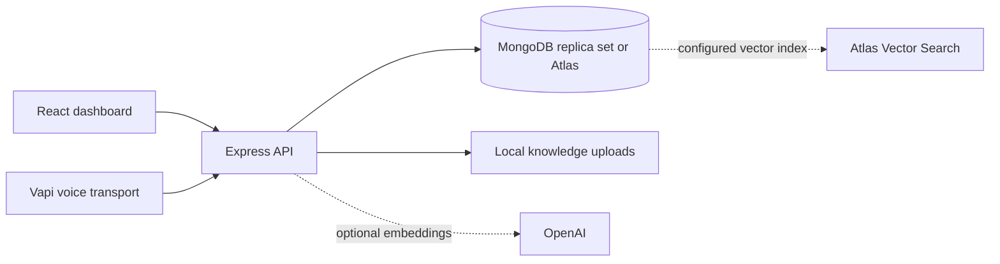

# Architecture

## Overview

Carla is a local sales development workspace. The Express backend owns the agent policy, CRM,
conversation history, summaries, bookings, and document retrieval. React/Vite is the dashboard and
optional Vapi browser voice is a transport layer.



## RAG workflow

`POST /api/knowledge/documents/upload` accepts one PDF, DOCX, or TXT multipart file (10 MB max).
The server assigns an opaque ID and disk name, stores the original in `uploads/knowledge`, records
metadata, extracts text with `pdf-parse` or `mammoth` (TXT uses UTF-8), normalizes whitespace,
chunks it with configurable character bounds, and persists chunks. Failed extraction or embedding
does not mark the document indexed. Failed stored files can be reprocessed. Same-workspace identical
bytes return the existing document.

With `RAG_EMBEDDINGS_ENABLED=true` and a valid backend `OPENAI_API_KEY`, the OpenAI
`text-embedding-3-small` model generates 1536 dimensional vectors for chunks and queries. When
`MONGODB_VECTOR_INDEX` names an available Atlas index, retrieval attempts `$vectorSearch` and filters
on the trusted workspace ID. If embedding or index lookup is unavailable, current retrieval falls
back to MongoDB text search. The Knowledge Base UI and search API report this as
`mongodb_text_search_fallback`; text search is not semantic vector search. No Atlas index or live
semantic query has been verified in this local workspace.

## Atlas Vector Search index

Create an Atlas Vector Search index on the `knowledgechunks` collection named
`knowledge_chunks_vector` (or set `MONGODB_VECTOR_INDEX` to your chosen name):

```json
{
  "fields": [
    { "type": "vector", "path": "embedding", "numDimensions": 1536, "similarity": "cosine" },
    { "type": "filter", "path": "workspaceId" }
  ]
}
```

The application does not create Atlas Search indexes. Confirm the Atlas index reaches READY and run
the Knowledge Base search UI with `RAG_EMBEDDINGS_ENABLED=true` before describing vector retrieval
as operational.

## Workspace and data model

`currentWorkspaceId()` in `src/server/services/workspaceContext.ts` reads only server configuration
(`DEFAULT_WORKSPACE_ID`, default `workspace_default`). Client body/query workspace IDs are never
used as authorization. Knowledge documents and chunks both store `workspaceId`; every list, read,
delete, reprocess, and retrieval query scopes to that value. This local MVP has no login or user
membership. It is not a multi-tenant authentication system.

MongoDB collections are Mongoose models: `leads`, `calls`, `conversations`, `summaries`,
`appointments`, `knowledgedocuments`, `knowledgechunks`, and `agentconfigurations`. Calls retain
the conversation transcript in `conversations`, and have structured tool and analysis data.
Summaries are unique per call. Appointment slots are uniquely reserved in MongoDB and rechecked in
the booking operation. Analytics currently derive from saved call and lead records in dashboard
state; no separate analytics warehouse is used.

## Carla and language

Carla's LLM system prompt calls retrieved content untrusted reference data and requests matching
English/Hindi replies. Product facts must use the verified excerpt and source ID. The structured
response policy rejects unsupported quotes. Hindi knowledge queries are recognized by the product
question detector; retrieval fallback tokenizes Unicode words. Deterministic mode remains available
without OpenAI and does not make embedding calls unless explicitly enabled.

## Appointments, calls, and analytics

Carla offers available MongoDB slots only after a scheduling request. The customer must select one
of the offered options. The backend checks availability again and commits the booking with the call
result. Direct booking APIs require an explicit `slotId`; duplicate reservations return conflict.
Call ending persists transcript, summary, qualification evidence, outcome, and sentiment analysis.
The dashboard's overview and analytics use saved calls and backend leads, but some reporting views
are still client aggregation rather than a dedicated aggregate API.

## Limits

- One trusted local workspace; no authentication or organization membership.
- Upload originals are local disk files and need backup by the laptop owner.
- Scanned PDFs without extractable text fail and need OCR outside this implementation.
- Vector search requires an Atlas Vector Search index and OpenAI embeddings configuration.
- Appointment data is internal; no calendar invite is sent.
- Vapi voice requires provider credentials and a public HTTPS callback URL.
